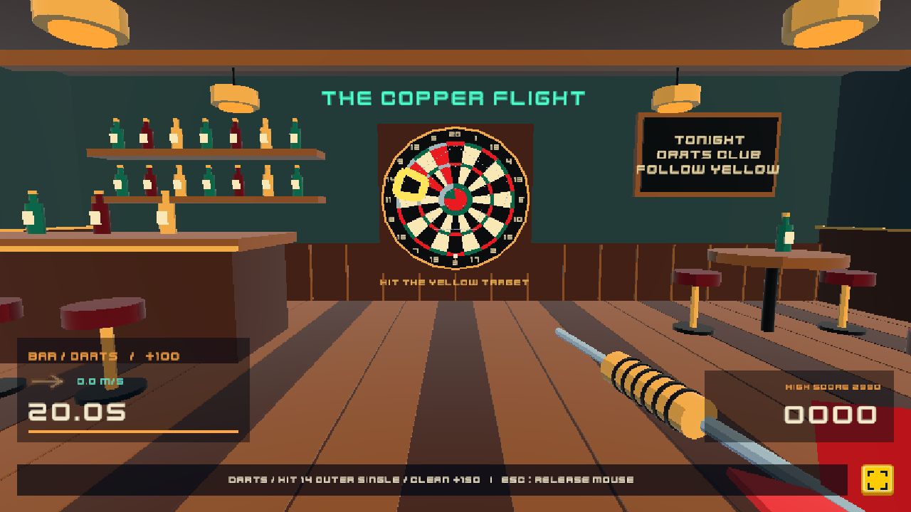
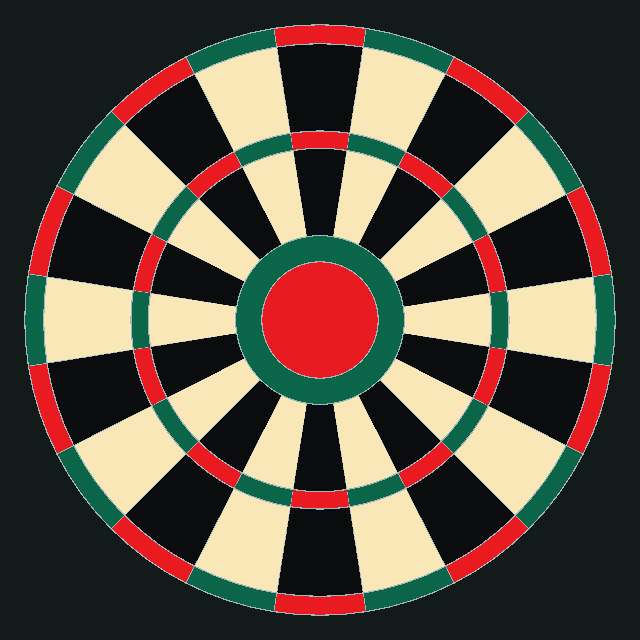

# 酒吧飛鏢關卡驗證

日期：2026-11-16。Unity Editor：6000.3.11f1。

第六關接在住家信箱後，命中當次黃色外框標示的區域後回到房間。六關共用 20 秒倒數。目標基礎 100 分，無先前碰撞加 150 分；此關不計反彈分。飛鏢維持 22 m/s 沿視線出手並受重力影響，無風。

## 每次進場隨機目標

包含首次進場、正常輪替再次進入、固定酒吧模式命中後，以及新回合重玩，都會重新抽選目標，連續兩次不重複。同一區域會保留至命中或離開該次關卡，漏投不重新抽選。

82 個候選區域包括紅心、中央綠環，以及 20 個數字扇區的內單倍、三倍、外單倍、雙倍區。區域只決定命中範圍，分數仍統一為基礎 100 分。黃色描邊、命中範圍、計分平面瞄準中心與 HUD 提示使用同一份選區資料。

鏢尖半徑為 0.018 m，必須完整進入當次區域：圓心距離符合內外半徑，扇形兩側也須容納鏢尖。未選區域、背面與牆面不計分。漏投飛鏢固定在撞擊表面，回收再投會解除固定。

## 投擲距離先縮短 20%，再縮短目前距離的 10%

只在酒吧套用 `StageData.playerForwardOffset`，攝影機、手持飛鏢、軌跡與出手點一起向前移動約 2.33877 m。以預設瞄準方向計算，出手點至標靶平面的深度距離由 8.352739 m 先變成 6.682191 m，再縮為 6.013972 m；目前為初始距離的 72%（0.8 × 0.9），累計縮短 28%。投擲線同步向前移；切換其他關卡時攝影機還原至原位置，不影響其他關卡的投擲手感。

## Play Mode 驗證

`TossRush.Editor.DartsStageValidation.Begin()` 在持續運行的實際玩家迴圈中執行，106 項檢查全數通過，詳見 [原始結果](DartsStageChecks.json)。

- 首次進場即選出有效區域與相符描邊。
- 2,048 次進場涵蓋所有 82 區，無相鄰重複；每次外框、遮罩與計分平面均跟隨選區。
- 所有區域均可容納實際鏢尖。
- 距離實測為原本的 72%，即前一次距離的 90%；切回房間時還原攝影機位置。
- 從實際玩家出手點透過 ThrowController 逐一命中所有 82 區，均得到 250 分。
- 選中一般扇區時，未選中的紅心不計分；選中紅心時，周圍綠環不計分。相鄰扇區與先前的目標均不計分。
- 連續固定酒吧遊玩時，命中後仍停留酒吧，但會抽出不同目標。
- 背面、牆面、倒數結束後的在途飛鏢不計分，漏投固定與重用仍正常。
- 信箱命中後進入酒吧，酒吧命中後回到房間，沒有重複計分。信箱輪替檢查使用程式送出有效命中，未重新測試信箱物理。
- Unity Console 無錯誤或警告。

本次限 Unity Editor 驗證，未執行平台建置。

## 資產與描邊

82 區的參數與 164 個遮罩／外框網格保存於 `Assets/TossRush/Data/DartboardLayout.asset`；遊玩中只切換已保存的網格，不建立新場景物件或網格。仍使用共用 `TargetSilhouetteMask` 與 `TargetOutline` 材質及 8 px 描邊，沒有新增碰撞體或陰影。

紅心被選中時，黃色仍限制在其周圍綠環內；其他區域則沿當次區域邊界描邊。完整標靶外圍不會整圈加亮。

更新入口為 **TossRush → Apply Random Dartboard Targets**，完整重建入口為 **TossRush → Add Bar Darts Stage**。重複更新仍維持 82 區、164 個網格，以及一組 OutlineMask／Outline，不新增重複項目。

## 預覽與試玩

Unity 選單 **TossRush → 固定關卡測試 → 酒吧（飛鏢）**，再按 Play 與 LET'S TOSS；命中後會重新抽選另一區域。測試後選 **恢復正常輪替**。

## 標靶左上方錯色修正

標靶網格曾只複製序列化資料，導致繪製時仍沿用舊的頂點／材質區段，左上方與紅心出現混色。更新方式改為一起刷新頂點、法線、所有材質區段與繪製緩衝；既有網格資產保留原參照。

保存並重新載入後，實際標靶與依相同資料新建的網格，640 × 640 共 409,600 像素完全一致；也確認圖片包含紅心與六種實際顏色，非空白渲染。Unity 編譯成功，Console 無錯誤或警告。此修正沒有變更選區、計分或投擲距離。

